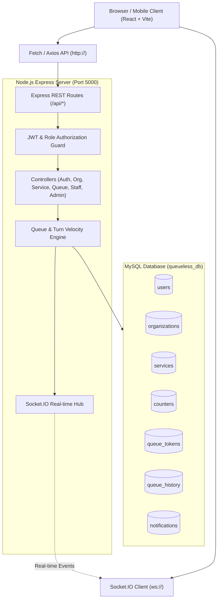

# QUEUELESS – UNIVERSAL MULTI-SERVICE VIRTUAL QUEUE MANAGEMENT SYSTEM

> A production-grade, full-stack virtual queue management platform built with React, Node.js, Express, MySQL, and Socket.IO.

---

## 🌟 1. Project Overview

**QueueLess** is an intelligent, universal queue management ecosystem created to eliminate physical lines across **hospitals, banks, restaurants, government offices, colleges, salons, pharmacies, and vehicle service centers**.

Instead of waiting on foot in crowded waiting halls, customers join virtual queues on their phone or desktop, receive sequential daily digital tokens (e.g. `H-001`, `B-024`), monitor live estimated waiting times and people ahead in real-time, and get notified immediately when their turn approaches or is called.

---

## 🚀 2. Technology Stack

### Frontend:
- **React.js 18 (Vite)**
- **JavaScript (ES6+)**
- **Tailwind CSS 3**
- **Lucide React** (Modern Icons)
- **Recharts** (Interactive administrative charts & analytics)
- **Socket.IO Client** (Real-time live queue bi-directional events)
- **React Router DOM v6** (Role-based protected client routing)

### Backend:
- **Node.js & Express.js**
- **Socket.IO** (Real-time queue broadcast engine)
- **MySQL2 / Promise Pool** (High-throughput relational transactions)
- **JWT (JSON Web Tokens)** (Stateless authorization)
- **bcryptjs** (Salted password security)
- **CORS & dotenv** (Config & cross-origin communication)

### Database:
- **MySQL / MariaDB** (Database: `queueless_db` on port 3306)
- ACID transactions for concurrency protection & token generation without race conditions.

---

## 🏛️ 3. System Architecture



---

## 🗄️ 4. Database Structure (`queueless_db`)

The database consists of 8 interconnected tables with foreign key constraints, cascade rules, and optimized indexes:

1. **`users`**: Customer, Staff, and Admin credentials, contact details, role (`CUSTOMER`, `STAFF`, `ADMIN`), and account status.
2. **`organizations`**: Name, sector (`Hospital`, `Bank`, `Restaurant`, `Government Office`, etc.), street address, city location, opening/closing hours, and operational status.
3. **`branches`**: Physical locations and regional departments under an organization.
4. **`services`**: Service offerings per organization, prefix (`H`, `B`, `R`, `G`), `average_service_time` (minutes), and `max_capacity`.
5. **`counters`**: Service windows or consultation chambers assigned to individual staff officers.
6. **`queue_tokens`**: Daily tokens with `sequence_num`, `token_date`, status (`WAITING`, `NEAR_TURN`, `SERVING`, `COMPLETED`, `SKIPPED`, `ON_HOLD`, `CANCELLED`), timestamps (`joined_at`, `called_at`, `completed_at`).
7. **`notifications`**: In-app notifications pushed in real-time via Socket.IO with read/unread tracking.
8. **`queue_history`**: Permanent chronological audit log for waiting duration metrics, analytics, and college project reporting.

---

## ⚙️ 5. Installation & Setup Guide

### Prerequisites
- Node.js (v18+ or v20+)
- MySQL or XAMPP (running on port 3306)
- Git (optional)

### Step 1: Initialize Database
Start MySQL (e.g. from XAMPP Control Panel) and execute the schema and seed files:

```bash
# In MySQL terminal or PowerShell:
mysql -u root -e "CREATE DATABASE IF NOT EXISTS queueless_db;"
mysql -u root queueless_db < database/schema.sql
mysql -u root queueless_db < database/seed.sql
```

### Step 2: Backend Setup
```bash
cd backend
npm install
node server.js
```
The server will start on `http://localhost:5000` with Socket.IO and MySQL connected.

### Step 3: Frontend Setup
```bash
cd ../frontend
npm install
npm run dev
```
Open `http://localhost:5173` in your browser.

---

## 🔑 6. Demo Accounts

| Role | Email | Password | Access Capabilities |
| :--- | :--- | :--- | :--- |
| **ADMIN** | `admin@queueless.com` | `admin123` | Full control: Analytics, Orgs, Services, Counters, Users, Queues |
| **STAFF** | `staff@queueless.com` | `staff123` | Counter desk: CALL NEXT, COMPLETE, SKIP, HOLD, RESUME, CANCEL |
| **CUSTOMER** | `user@queueless.com` | `user123` | Browse organizations, join virtual queue, track live position |

*(Clickable one-click demo login buttons are also provided directly on the Login screen!)*

---

## 📱 7. Live Queue Algorithm & Calculation

### 1. Daily Sequential Token Generation
- When a customer clicks **JOIN QUEUE**, a MySQL transaction locks the service row for today (`token_date = CURDATE()`).
- The system reads `MAX(sequence_num)` for that specific service and date, increments it by 1, and prefixes it with the configured service prefix (e.g. `H-001`, `H-002`).
- Guaranteed consecutive numbers with automatic daily reset at midnight.

### 2. People Ahead Calculation
$$\text{People Ahead} = \text{COUNT}(\text{tokens where service\_id} = S \text{ and status} \in \{\text{'WAITING'}, \text{'NEAR\_TURN'}\} \text{ and sequence\_num} < \text{current\_sequence})$$

### 3. Estimated Waiting Time
$$\text{Estimated Wait (minutes)} = \text{People Ahead} \times \text{Service Average Time (e.g. 15 mins)}$$

### 4. Proactive "Near Turn" Trigger
When a customer has $\le 2$ people ahead of them, their status automatically upgrades to `NEAR_TURN` and a high-priority Socket.IO alert is pushed to notify them to head toward the counter.

---

## 📡 8. REST API Endpoints

### Authentication
- `POST /api/auth/register` — Register customer or staff
- `POST /api/auth/login` — Login & receive JWT token
- `POST /api/auth/logout` — Logout
- `GET /api/auth/profile` — Fetch current user profile

### Organizations & Discovery
- `GET /api/organizations` — List organizations with search, category, and location filters
- `GET /api/organizations/:id` — Get single organization with all services and queue sizes
- `POST /api/organizations` — Add organization (Admin)
- `PUT /api/organizations/:id` — Update organization (Admin)
- `DELETE /api/organizations/:id` — Delete organization (Admin)

### Services
- `GET /api/services/:organizationId` — List services under an organization
- `POST /api/services` — Create new service (Admin)
- `PUT /api/services/:id` — Update service (Admin)
- `DELETE /api/services/:id` — Delete service (Admin)

### Queue Operations
- `POST /api/queue/join` — Customer joins virtual queue and receives digital token
- `GET /api/queue/my-active` — Get all active tokens for customer
- `GET /api/queue/my-history` — Customer past completed/cancelled queue history
- `GET /api/queue/:tokenId` — Get single token real-time status and people ahead
- `POST /api/queue/:tokenId/leave` — Customer cancels/leaves queue

### Staff Desk
- `GET /api/queue/staff/assignment` — Fetch staff assigned counter and service queues
- `POST /api/queue/call-next` — Call next waiting customer into `SERVING` status
- `POST /api/queue/complete` — Mark current customer visit as `COMPLETED`
- `POST /api/queue/skip` — Mark absent customer as `SKIPPED`
- `POST /api/queue/hold` — Place current customer on `ON_HOLD`
- `POST /api/queue/resume` — Resume `ON_HOLD` customer back to active queue
- `POST /api/queue/cancel` — Cancel token with custom reason

### Admin Dashboard & Analytics
- `GET /api/admin/dashboard` — Overview statistics
- `GET /api/admin/analytics` — Data for Recharts (customer trend, peak hours, category distribution)
- `GET /api/admin/users` — User directory
- `GET /api/admin/counters` — Manage service counters
- `GET /api/admin/queues` — Master real-time queue view

---

## 🎓 9. Viva Questions & Model Answers

**Q1: What problem does QueueLess solve compared to traditional physical token machines?**  
*Answer:* Physical token machines require customers to be physically present in overcrowded rooms, leading to fatigue, health risks, and wasted time. QueueLess digitizes the entire lifecycle via virtual queues—customers join remotely, monitor exact people ahead, and receive Socket.IO alerts so they only arrive when called.

**Q2: How is real-time synchronization implemented without page refreshing?**  
*Answer:* We use bi-directional WebSockets via Socket.IO. When a staff member clicks `CALL NEXT`, the backend emits a `queue_updated` event to the service room. All connected customer browser screens react immediately to update the currently serving token and reduce their people ahead count.

**Q3: How are duplicate tokens prevented under concurrent requests?**  
*Answer:* Token creation is wrapped in a MySQL ACID database transaction. We lock the sequence calculation for today's date and enforce an atomic increment of `sequence_num`.

**Q4: How does the system adapt to different organizations like hospitals vs restaurants?**  
*Answer:* QueueLess uses a universal data model: each place is an `Organization` belonging to a category, with customizable `Services` (e.g. OPD Consultation vs Dining Table Waiting) and configurable `token_prefix`, `average_service_time`, and `max_capacity`.

**Q5: How does the system handle absent customers?**  
*Answer:* The staff calling desk provides dedicated `SKIP` and `HOLD` actions. If a customer is not present, staff can put them on hold to attend the next person, and resume them later with a single click.
